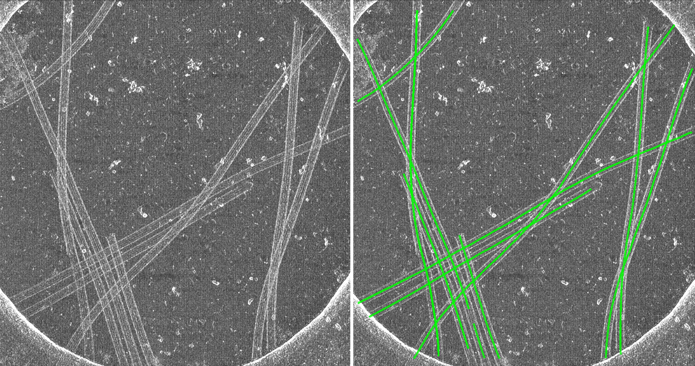

# cylindra-tradis

A `cylindra` plugin for segmentation using [TRADIS](https://github.com/SMLC-NYSBC/TARDIS) and fully-automated spline registration.



This plugin was generated with [cookiecutter](https://github.com/cookiecutter/cookiecutter).

## Installation

```bash
pip install cylindra-tradis
```
